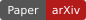
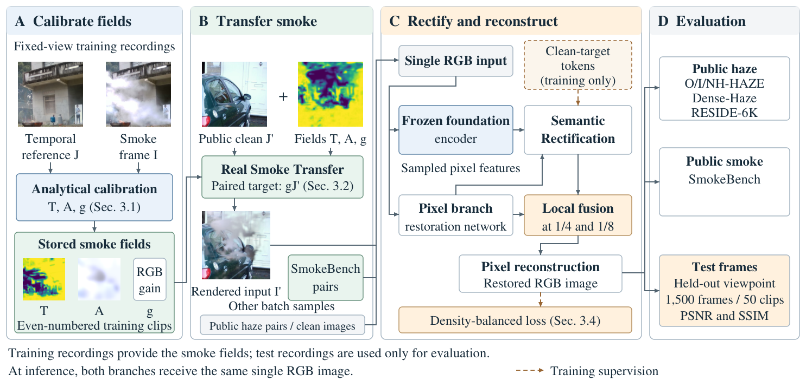

<div align="center">

# FireDesmoke

### Fire Smoke Removal via Real Smoke Transfer and Semantic Rectification

[](https://arxiv.org/abs/2611.30057)
[](https://ron941.github.io/FireDesmoke/)
[](#interactive-demo)
[](docs/model_assets.md)

Chih-Chung Hsu, Rong-Lin Jian

</div>

**FireDesmoke** removes fire smoke from a single RGB image. Real Smoke Transfer renders calibrated smoke fields from training recordings onto clean images to form training pairs. Semantic Rectification uses local pixel features to rectify degraded semantic tokens before local fusion with the restoration network. Clean-target features supervise training only; inference needs no clean reference.

This repository provides the model, inference code, four result tables and a single-image demo. The two trained checkpoints are available separately from the authors. The restoration network uses **AdaIR + frozen DINOv3 ViT-L/16**. Training and scoring programs are not included.

## Quick start

### 1. Install

The local inference checks use Linux, Python 3.13, PyTorch 2.7.1 / CUDA 12.6 and an RTX 3090. The authors report PyTorch 2.6.0 / CUDA 12.4 on an RTX 4060 Ti. GPU inference is the tested path; cross-device bitwise equality is not assumed.

```bash
git clone https://github.com/ron941/FireDesmoke.git
cd FireDesmoke
python3 -m venv .venv
source .venv/bin/activate
python -m pip install torch==2.7.1 torchvision==0.22.1 --index-url https://download.pytorch.org/whl/cu126
python -m pip install -e '.[demo,test,conversion]'
python -m pip check
```

See [tested environment versions](requirements/validated-linux.txt).

### 2. Prepare weights and dependencies

Obtain the two FireDesmoke checkpoints from the authors and the authorized official DINOv3 ViT-L/16 LVD-1689M weight. AdaIR supplies architecture code only; its pretrained restoration weights are not needed.

```bash
firedesmoke download --model firedesmoke --source /path/to/firedesmoke_full.pt
firedesmoke download --model firedesmoke-smokebench --source /path/to/firedesmoke_smokebench.pt
python scripts/fetch_dependencies.py --dinov3-weights /path/to/dinov3_vitl16_pretrain_lvd1689m.pth
```

The setup script checks checkpoint hashes, clones pinned official code, and writes the ignored `.local/asset_locations.json`. An independently verified conversion of the official Hugging Face weight is also supported; follow [DINOv3 compatibility](docs/dinov3_weights.md). See [model assets](docs/model_assets.md) for existing local repositories and explicit configuration.

### 3. Restore images

```bash
firedesmoke infer --model firedesmoke --input /path/to/images --output .local/restored
# SmokeBench paper results use the separately trained model:
firedesmoke infer --model firedesmoke-smokebench --input /path/to/smokebench --output .local/smokebench-restored
```

Native inference preserves input resolution. It uses overlapping 384×384 windows (stride 96), linear overlap blending and horizontal-flip averaging. The SmokeBench model uses 320×320 windows (stride 80). Inputs are reflect-padded to multiples of 16 and outputs cropped to their original size. RGB PNG outputs use the authors' half-up 8-bit conversion. Output directories must be empty; `_run.json` records checkpoint hashes, settings, input/output hashes and completion status.

The supplied standalone inference remains available as `python -m firedesmoke.infer --help`. Its `--no-flip` and `--whole` options are speed alternatives, not the settings used for the reported tables. The website's saved restoration comparisons use the default paper inference.

## Interactive demo

```bash
firedesmoke demo --model firedesmoke --port 7860
```

Open `http://127.0.0.1:7860/`. Choose an example or upload a PNG/JPEG, restore, compare and download. The demo uses the full model with default windowed inference; its upload adapter applies EXIF orientation and limits the longest side to 640 pixels using Lanczos. This size adaptation is separate from native benchmark inference. Demo examples from SmokeBench still use the full demo model and are not the FireDesmoke* benchmark result.

```bash
python scripts/serve_site.py --port 8080
```

The static website runs separately at `http://127.0.0.1:8080/` and requires no GPU. Both services bind to localhost by default.

## Method and results

<p align="center">
  
</p>

The AdaIR pixel branch and frozen DINOv3 ViT-L/16 encoder provide local restoration features and semantic tokens. Semantic Rectification uses four encoder layers (6, 12, 18, 24), followed by local fusion at 1/4 and 1/8 resolution. The two checkpoints contain approximately 30.87M model parameters, excluding the separately loaded frozen encoder.

Reported results from the four accompanying CSV files:

| Dataset / model | Reported result |
|:--|:--|
| Fire test, FireDesmoke | Dense / medium / clear / overall PSNR: 18.89 / 20.70 / 30.93 / 26.53 dB; overall SSIM 0.887; object PSNR 28.23 dB |
| SmokeBench, FireDesmoke* | Y-PSNR 30.47 dB; Y-SSIM 0.890; LPIPS 0.137 |
| RealX3D, FireDesmoke | RGB PSNR 18.19 dB; SSIM 0.712 |
| Public haze, FireDesmoke | O-HAZE 25.65; I-HAZE 22.35; NH-HAZE 19.49; Dense-Haze 15.96; RESIDE-6K 30.92 dB |

All methods and original annotations are retained in [results](results/). FireDesmoke* is trained only on the SmokeBench training split. The complete model is used for the other datasets. See [evaluation status](docs/evaluation.md), [model cards](docs/provenance_model_cards.md) and [validation evidence](docs/validation.md). Dense smoke can conceal details that a single image cannot recover.

## Licensing and citation

Chih-Chung Hsu, Rong-Lin Jian. *FireDesmoke: Fire Smoke Removal via Real Smoke Transfer and Semantic Rectification*. [arXiv:2611.30057](https://arxiv.org/abs/2611.30057) [cs.CV], 2026.

For AdaIR and DINOv3 licensing, see [third-party notes](docs/third_party.md). Model checkpoints are distributed separately.
